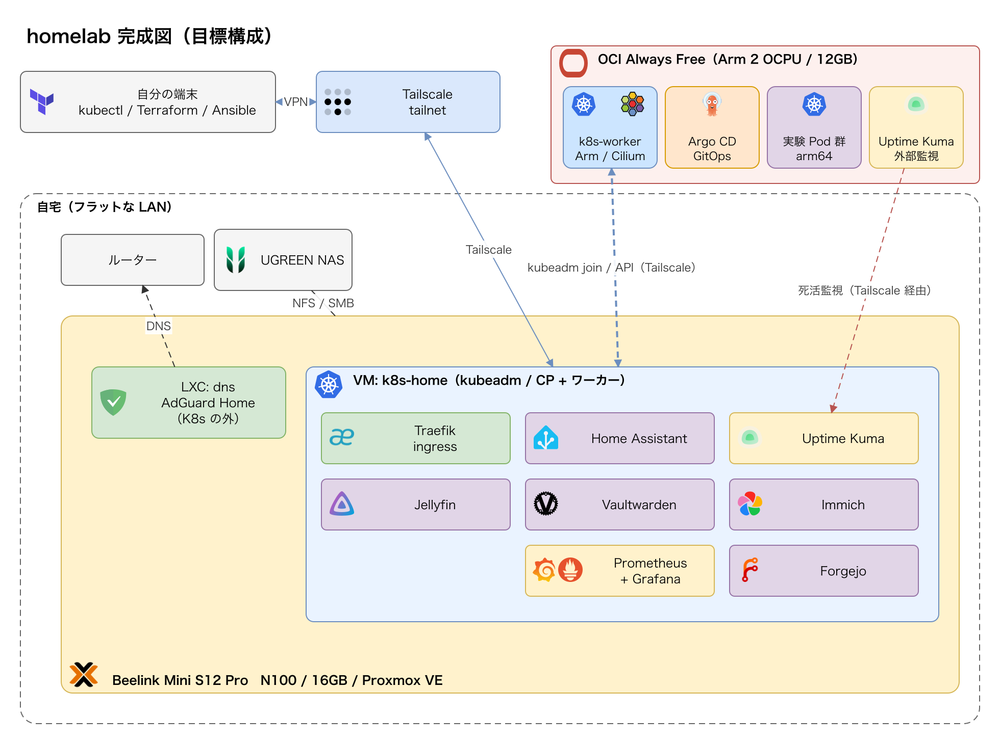
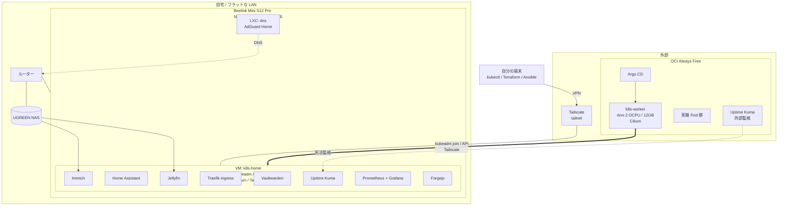

# 設計図



## 構成一覧

### 自宅側

| 項目 | 内容 |
|---|---|
| ホスト OS | Proxmox VE |
| DNS | AdGuard Home |
| 独自ドメイン | 取得しない |
| 外出先からのアクセス | Tailscale のみ |
| 認証 | 各サービスで個別に認証する（1 人 1 アカウント）。アクセスは Tailscale 経由のみ |
| 家族のアクセス | Tailscale のタグとポートの設定で、家族はサービスのポートだけにアクセスできる。管理者はすべてのポートにアクセスできる |
| ネットワーク | フラットな LAN |
| ストレージ | UGREEN NASync DH2300（2 ベイ、1GbE、Docker なし） |
| バックアップ | restic |
| 監視 | Prometheus + Grafana + Uptime Kuma |

### Kubernetes

| 項目 | 内容 |
|---|---|
| K8s | 必須 |
| ディストリビューション | kubeadm |
| 自宅側の構成 | 案 B: Proxmox の上に K8s 用の VM を 1 台作る（コントロールプレーンとワーカーを兼ねる） |
| コンテナランタイム | containerd |
| 自宅のサービス | K8s の Pod |
| OCI ワーカー | Arm 1 台（2 OCPU / 12GB） |
| CNI | Cilium |
| デプロイ | GitOps（Argo CD） |
| OCI のアクセス | Tailscale 内のみ |
| OCI の構築 | Terraform + Ansible |

## 全体図



## 自宅の構成要素

| 名前 | 種類 | 中身 |
|---|---|---|
| Proxmox VE | ホスト OS | VM と LXC を管理する |
| k8s-home | VM | kubeadm（コントロールプレーン + ワーカー）、containerd、Cilium、Tailscale |
| dns | LXC | AdGuard Home |
| Traefik | Pod | ingress |
| Jellyfin、Home Assistant、Vaultwarden、Immich、Forgejo、Uptime Kuma、Prometheus + Grafana | Pod | 各サービス |

## OCI の構成要素

| 名前 | 中身 |
|---|---|
| k8s-worker | Arm 1 台（VM.Standard.A1.Flex、2 OCPU / 12GB）、Cilium |
| Argo CD | GitOps コントローラ |
| 実験 Pod 群 | 学習用のワークロード |
| Uptime Kuma（外部） | 自宅サービスの外部監視 |

## リポジトリ構成の案

```
homelab/
├── ansible/        # Proxmox ホスト、VM の OS、OCI の OS 設定
├── terraform/      # OCI（ネットワーク、Arm インスタンス）
├── k8s/            # kubeadm の設定、Argo CD の Application、各サービスの素の manifest（Helm なし）
├── docs/           # ログ、学習ノート、完成図
└── README.md
```
